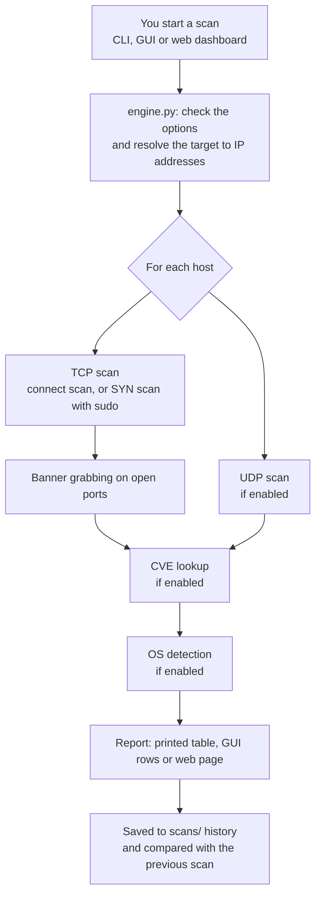

# Port Scanner: Cyber Security Mini Project

**Live demo:** [https://naga52141.github.io/port-scanner](https://naga52141.github.io/port-scanner/) (replays a recorded scan; the real scanner runs locally)

A network port scanner written in Python. It finds open TCP and UDP ports, identifies the running services and their versions, looks up known vulnerabilities (CVEs), guesses the operating system, and tracks changes between scans. It has three interfaces: a command-line tool, a desktop GUI and a web dashboard.

> **Legal notice:** Only scan systems you own or have written permission to test. Unauthorised port scanning can break the law (for example, the Computer Misuse Act in the UK or the CFAA in the US) and network policies. Safe targets: `127.0.0.1`, your own home lab or VMs, and `scanme.nmap.org`, which the Nmap project provides for testing.

**Contents:** [Features](#features) · [Getting started](#getting-started-step-by-step) · [Using the scanner](#using-the-scanner) · [How the project works](#how-the-project-works) · [Defending against port scans](#defending-against-port-scans) · [Limitations](#limitations)

## Features

| Feature | What it does |
|---|---|
| TCP connect scan | Multithreaded full-handshake scan; needs no special privileges |
| SYN (half-open) scan | Raw-packet scan with scapy; stealthier and faster, needs root |
| UDP scan | Sends protocol-correct probes (DNS, NTP, SNMP, NetBIOS, SSDP, Memcached) |
| Banner grabbing | Reads service greetings and HTTP `Server:` headers to find software versions |
| Risk notes | Flags dangerous exposed services (Telnet, SMB, RDP, Redis, SNMP and others) |
| CVE lookup | Matches detected versions against the NIST NVD database and ranks CVEs by CVSS score |
| OS fingerprinting | Guesses the OS from ping TTL, TCP window size and banners, and shows the evidence |
| Scan history and comparison | Saves every scan and reports new, closed or changed ports since the last one |
| Reports | JSON or CSV export |
| Interfaces | Command line, Tkinter desktop GUI, Flask web dashboard |

## Getting started (step by step)

New to Python projects? Follow these steps in order. They take about 5 minutes.

### Step 1: Install the tools you need

You need **Python 3.8 or newer** and **Git**. To check whether you already have them, open a terminal:

- **Windows:** press Start, type `cmd` and open **Command Prompt** (or use PowerShell).
- **macOS:** press Cmd+Space, type `Terminal` and press Enter.
- **Linux:** open your Terminal app.

Then run:

```bash
python3 --version    # Windows: python --version
git --version
```

If either command says "not found", install it:

| Tool | Windows | macOS | Linux (Ubuntu/Debian) |
|---|---|---|---|
| Python | [python.org/downloads](https://www.python.org/downloads/). **Tick "Add python.exe to PATH"** in the installer | [python.org/downloads](https://www.python.org/downloads/) | `sudo apt install python3 python3-venv python3-tk` |
| Git | [git-scm.com/download/win](https://git-scm.com/download/win) | `xcode-select --install` | `sudo apt install git` |

Close and reopen the terminal after installing, then check the versions again.

### Step 2: Download the project

```bash
git clone https://github.com/naga52141/port-scanner.git
cd port-scanner
```

No Git? On the GitHub page, click **Code → Download ZIP**, unzip it, then `cd` into the folder in your terminal.

### Step 3: Create a virtual environment and install the packages

A **virtual environment** (`.venv`) is a private folder of Python packages for this project only, so it doesn't interfere with anything else on your computer.

**macOS / Linux:**
```bash
python3 -m venv .venv
source .venv/bin/activate
pip install -r requirements.txt
```

**Windows (Command Prompt):**
```bat
python -m venv .venv
.venv\Scripts\activate
pip install -r requirements.txt
```

**Windows (PowerShell):**
```powershell
python -m venv .venv
.venv\Scripts\Activate.ps1
pip install -r requirements.txt
```

When the environment is active, your prompt starts with `(.venv)`. Activate it again (the second line) **every time you open a new terminal** to work on this project.

### Step 4: Check that it works

```bash
python port_scanner.py --help
```

You should see the list of options. If you do, setup is done.

### Step 5: Run your first scan

Scan your own computer. It is always safe and legal:

```bash
python port_scanner.py 127.0.0.1
```

You'll get a table of the open ports on your machine. If none show up, give the scanner something to find: open a **second** terminal, go to any folder and run `python3 -m http.server 8000` (Windows: `python -m http.server 8000`). Then scan again in the first terminal:

```bash
python port_scanner.py 127.0.0.1 -p 8000 --os
```

Port 8000 now shows as **open**, with the web server's banner. Stop the test server with Ctrl+C when you're done.

Next, try every check at once (CVE lookup needs internet and takes a little longer):

```bash
python port_scanner.py 127.0.0.1 -p top -A
```

### Step 6: Try the GUI and the web dashboard

```bash
python gui.py            # opens a desktop window
python web_app.py        # then open http://127.0.0.1:5050 in your browser
```

Press **Ctrl+C** in the terminal to stop the dashboard.

### Troubleshooting

| Problem | Fix |
|---|---|
| `python3: command not found` (Windows) | On Windows, use `python` instead of `python3`. If that fails too, reinstall Python with **"Add python.exe to PATH"** ticked. |
| PowerShell: `running scripts is disabled on this system` | Run `Set-ExecutionPolicy -Scope CurrentUser RemoteSigned` once, or use Command Prompt instead. |
| `ModuleNotFoundError: No module named 'flask'` (or `scapy`) | The virtual environment isn't active. Run the activate command from Step 3, then `pip install -r requirements.txt`. |
| `No module named '_tkinter'` when running `gui.py` | Linux: `sudo apt install python3-tk`. macOS with Homebrew Python: `brew install python-tk`. The python.org installers include it. |
| `Address already in use` for the web dashboard | Another program is using port 5050. Choose another: `PORT=5051 python web_app.py` (Windows CMD: `set PORT=5051` then `python web_app.py`; PowerShell: `$env:PORT=5051` then `python web_app.py`). |
| `SYN scan needs root - run with sudo` | The SYN scan needs admin rights: `sudo .venv/bin/python port_scanner.py <target> --syn`. On Windows, also install [Npcap](https://npcap.com) and run the terminal as Administrator. The normal scan works without any of this. |
| CVE lookup is slow or says `lookup failed` | It needs internet, and NVD limits free requests, so the scanner pauses about 6 seconds between products. Get a free key (see [CVE lookup](#cve-lookup-cvepy)) to speed it up. |
| Every UDP port shows `open\|filtered` | That's normal for UDP when a firewall drops packets or a service doesn't reply. See [UDP scan](#udp-scan-corepy-scan_udp_port). |
| Scan finds nothing on another computer | That computer's firewall is probably blocking the probes. Try a longer timeout: `--timeout 2`. |

## Using the scanner

### 1. Command line

```bash
source .venv/bin/activate

python port_scanner.py 127.0.0.1                         # TCP ports 1-1024
python port_scanner.py 127.0.0.1 -p top -A               # common ports + UDP + OS + CVEs
python port_scanner.py scanme.nmap.org -p top --cve -o report.json
python port_scanner.py 192.168.1.0/24 -p 22,80,443 --os  # whole home network
python port_scanner.py 127.0.0.1 --udp --udp-ports 53,123,161
python port_scanner.py 127.0.0.1 --compare last          # what changed since last scan?
sudo .venv/bin/python port_scanner.py 192.168.1.10 --syn # SYN scan (needs root)
```

| Option | Description | Default |
|---|---|---|
| `target` | IP, hostname, or CIDR range | required |
| `-p, --ports` | TCP ports: `22,80`, `1-1024`, `top`, `all`, or `""` for none | `1-1024` |
| `-u, --udp` | Also scan UDP | off |
| `--udp-ports` | UDP ports to scan | common UDP services |
| `-s, --syn` | SYN scan instead of connect scan (sudo) | off |
| `-O, --os` | OS fingerprinting | off |
| `-c, --cve` | CVE lookup (needs internet) | off |
| `-A, --all-checks` | Same as `--udp --os --cve` | off |
| `-t, --threads` | Concurrent connections | `200` |
| `--timeout` | Seconds to wait per connection | `0.5` |
| `--no-banner` | Skip banner grabbing | off |
| `-o, --output` | Save report (`.json` or `.csv`) | none |
| `--compare` | Compare with `OLD.json`, or `last` (previous scan of the same target) | none |
| `--no-history` | Don't save this scan to `scans/` | off |

Press **Ctrl+C** to stop a scan early. Results found so far are still saved.

### 2. Desktop GUI

```bash
python gui.py
```

Fill in the target and ports, tick the checks you want, and press **Start scan**. Rows are coloured by risk: red for a critical CVE (CVSS 9+), orange for a high CVE or risky service, and grey for open|filtered. Click a row to see its details, the OS evidence and CVEs; each CVE is a clickable link to the NVD page. Use **Save report...** to export, and **Compare with earlier scan...** to see the changes.

### 3. Web dashboard

```bash
python web_app.py
# then open http://127.0.0.1:5050
```

The dashboard shows live progress, summary cards (open ports, risky services, known CVEs, critical CVEs), a results table with CVE badges, OS fingerprints, automatic **changes since the last scan of this target**, and a scan history with download and compare.

For safety, the dashboard only listens on `127.0.0.1`. It also rejects requests with a foreign `Host` header (protection against DNS rebinding) and non-JSON requests (so other websites can't start scans through your browser).

## How the project works

This section explains the whole project from the ground up: the networking ideas it is built on, what happens when you run a scan, what every file does, and how each feature works.

### 1. The basics: IP addresses, ports and protocols

- An **IP address** identifies a computer on a network, for example `192.168.1.10`. `127.0.0.1` always means "this computer".
- A **port** is a numbered door on that computer, from 1 to 65535. Each network program listens on its own port: SSH on 22, websites on 80 (HTTP) and 443 (HTTPS), MySQL on 3306.
- A **port scanner** knocks on those doors to find out which ones are open. Each open port is a running service, and every running service is something an attacker could try to break into. Together they form the computer's **attack surface**.

Programs talk over two main protocols:

| | TCP | UDP |
|---|---|---|
| How it works | Sets up a connection first (a "handshake"), then sends data reliably | Just sends packets, with no connection and no guarantee they arrive |
| Used by | Websites, SSH, email, databases | DNS, NTP (time), SNMP, video and games |
| Easy to scan? | Yes: the handshake tells you clearly whether a port is open | No: silence can mean "open" or "blocked" |

**The TCP three-way handshake** is how every TCP connection starts:

```
Client                Server
  | ---- SYN --------->  |   "I'd like to connect"
  | <--- SYN-ACK ------  |   "OK" (the port is OPEN)
  | ---- ACK --------->  |   "Connected"
```

If nothing is listening, the server replies `RST` ("go away"), so the port is **closed**. If a firewall silently drops the packet, there is no reply at all, so the port is **filtered**.

### 2. What happens when you run a scan



Step by step:

1. **Parse the input.** `127.0.0.1` stays as it is, a hostname such as `scanme.nmap.org` is looked up to get its IP address, and a range such as `192.168.1.0/24` expands to 254 addresses. The port spec `1-1024` becomes a list of 1,024 numbers.
2. **Scan the ports.** 200 threads probe ports in parallel. One port at a time would take minutes; in parallel, 1,024 ports take under a second.
3. **Grab banners.** For each open port, the scanner reads what the service says about itself, for example `SSH-2.0-OpenSSH_8.2p1 Ubuntu`.
4. **Look up CVEs (optional).** The software name and version from the banner are checked against the US government's vulnerability database.
5. **Detect the OS (optional).** The scanner pings the host and combines the result with clues from the banners.
6. **Report.** Results are shown, saved to `scans/`, optionally exported to JSON or CSV, and compared with the previous scan of the same target.

### 3. What's in the project

```
port-scanner/
├── port_scanner.py      command-line interface
├── gui.py               Tkinter desktop GUI
├── web_app.py           Flask web dashboard (the server side)
├── templates/index.html web dashboard page (HTML, CSS and JavaScript)
├── scanner/             the scanning engine, shared by all three interfaces
│   ├── engine.py        runs a scan from start to finish
│   ├── core.py          parsing, TCP + UDP probes, banners, risk notes
│   ├── syn.py           SYN scan (scapy)
│   ├── cve.py           vulnerability lookup (NIST NVD)
│   ├── osdetect.py      OS fingerprinting
│   ├── compare.py       finds differences between two scans
│   └── report.py        JSON/CSV export and scan history
├── docs/                GitHub Pages demo site (replays a recorded scan)
├── requirements.txt     extra packages: scapy and flask
└── scans/               saved scan history (created automatically, not uploaded)
```

The project is split into two layers:

- **The engine** (`scanner/`) does all the scanning work. It doesn't know or care how results are displayed.
- **The interfaces** (`port_scanner.py`, `gui.py`, `web_app.py`) only collect your settings, start the engine and show what it reports.

Because of this split, all three interfaces get every feature without the scanning code being written three times.

#### File by file

| File | What it does | Key functions |
|---|---|---|
| [scanner/engine.py](scanner/engine.py) | Runs a full scan in order (TCP, UDP, CVE, OS) and builds the final report. Sends live updates to the interface through *callbacks*: functions the interface passes in, such as `on_result`, which is called each time an open port is found. | `ScanOptions`, `validate()`, `run_scan()` |
| [scanner/core.py](scanner/core.py) | The low-level networking: turns `"22,80,100-200"` into a port list, resolves hostnames, tests one TCP or UDP port, reads banners, and holds the lists of common ports and risky services. | `parse_ports()`, `parse_targets()`, `scan_tcp_port()`, `grab_banner()`, `scan_udp_port()` |
| [scanner/syn.py](scanner/syn.py) | Builds raw TCP packets with the scapy library for the SYN scan. | `syn_available()`, `syn_scan()` |
| [scanner/cve.py](scanner/cve.py) | Pulls the product and version out of a banner, asks the NVD API for its CVEs, filters and sorts them, and caches the answers. | `identify_software()`, `lookup_cves()`, `enrich_with_cves()` |
| [scanner/osdetect.py](scanner/osdetect.py) | Pings the host, reads the TTL and combines it with banner clues to guess the OS. | `ping_ttl()`, `detect_os()` |
| [scanner/compare.py](scanner/compare.py) | Compares two reports and lists new, closed and changed ports. | `compare_reports()`, `format_diff()` |
| [scanner/report.py](scanner/report.py) | Writes reports as JSON or CSV, keeps the history in `scans/`, and finds the previous scan of a target. | `save_report()`, `save_to_history()`, `previous_scan()` |
| [port_scanner.py](port_scanner.py) | The command-line tool. Reads options with `argparse`, prints live results and the final table, and stops cleanly on Ctrl+C. | `main()` |
| [gui.py](gui.py) | The desktop window, built with Tkinter. | `PortScannerApp` |
| [web_app.py](web_app.py) | A small Flask web server with a JSON API that the dashboard page calls. | `start_scan()`, `scan_status()`, `compare()` |
| [templates/index.html](templates/index.html) | The dashboard page. Its JavaScript starts a scan, then asks the server for progress twice a second and redraws the results. | `poll()`, `renderResults()` |
| [docs/](docs/) | The public demo site. `demo-data.js` holds two real recorded scans, and `index.html` replays them in the dashboard design. | `runDemo()` |

### 4. How each feature works

#### TCP connect scan ([core.py](scanner/core.py), `scan_tcp_port`)
The scanner opens a normal TCP connection with Python's `socket.connect_ex()`, which returns `0` when the handshake succeeds:

```python
with socket.socket(socket.AF_INET, socket.SOCK_STREAM) as sock:
    sock.settimeout(timeout)
    if sock.connect_ex((host, port)) != 0:
        return None          # closed or filtered
    banner = grab_banner(sock, port, host, timeout)
```

To make this fast, [engine.py](scanner/engine.py) hands every port to a `ThreadPoolExecutor`, a pool of 200 worker threads that each test one port at a time. Most of a scan is spent *waiting* for replies, so running 200 waits at once gives a large speed-up.

#### Banner grabbing ([core.py](scanner/core.py), `grab_banner`)
Many services introduce themselves as soon as you connect. An SSH server sends `SSH-2.0-OpenSSH_10.3`, and an FTP server sends `220 (vsFTPd 3.0.3)`. Web servers stay silent until asked, so for them the scanner sends an HTTP `HEAD` request and keeps the `Server:` header, for example `Server: Apache/2.4.41 (Ubuntu)`. If an unknown service stays silent, the scanner tries the HTTP request anyway, which catches web servers running on unusual ports.

Banners matter because they reveal **exact software versions**, and versions can be checked for known vulnerabilities.

#### Risk notes ([core.py](scanner/core.py), `TCP_RISK_NOTES` / `UDP_RISK_NOTES`)
These are built-in lists of services that are dangerous to expose, each with a short reason. Examples: Telnet (23) sends passwords as plain text, SMB (445) was attacked by WannaCry, and Redis (6379) often has no password at all.

#### SYN ("half-open") scan ([syn.py](scanner/syn.py))
Instead of completing the handshake, the scanner sends only the first `SYN` packet, built by hand with scapy, and reads the reply:

```
Scanner                Target
  | ---- SYN --------->  |
  | <--- SYN-ACK ------  |   the port is OPEN
  | ---- RST --------->  |   our OS cancels it, so no connection is ever made
```

The target application never sees a finished connection, so it usually doesn't log one. That's why the SYN scan is called "stealthier", and it is Nmap's default scan type. Building raw packets needs administrator rights, which is why it needs `sudo`.

| | Connect scan | SYN scan |
|---|---|---|
| Handshake | Full | Half (SYN, SYN-ACK, RST) |
| Needs root | No | Yes |
| Logged by target app | Yes | Usually not |

#### UDP scan ([core.py](scanner/core.py), `scan_udp_port`)
UDP has no handshake, so the scanner sends a packet and waits:

| What comes back | Meaning |
|---|---|
| A reply | **open** |
| An ICMP "port unreachable" message | **closed** |
| Nothing | **open\|filtered**: a firewall may have dropped it, or the service ignored it |

Most UDP services ignore packets they don't understand, so the scanner sends a real request for each service (`UDP_PROBES`): a DNS question to port 53, a time request to NTP on 123, and an SNMP query with the default password `public` to 161.

#### CVE lookup ([cve.py](scanner/cve.py))
A **CVE** is a publicly listed security bug with an ID such as `CVE-2023-38408`. Each CVE has a **CVSS** score from 0 to 10 that measures how serious it is (9 or higher is *critical*). The lookup has four steps:

1. **Find the software.** Regular expressions find product and version in the banner: `SSH-2.0-OpenSSH_8.2p1` becomes **OpenSSH 8.2**.
2. **Convert to a CPE.** A CPE is the standard name the database uses for software: `cpe:2.3:a:openbsd:openssh:8.2`.
3. **Ask the NVD.** The scanner calls the free API of the US National Vulnerability Database (NIST NVD), which returns every CVE that affects that version.
4. **Filter and sort.** The scanner keeps only CVEs where the product itself is vulnerable. For example, it drops a bug in a web app that merely runs *on* Python. It then sorts by CVSS score.

Answers are cached in `.cve_cache.json` for a week. Without a key, NVD allows about 5 requests every 30 seconds, so the scanner waits about 6 seconds between products. A free API key from [nvd.nist.gov](https://nvd.nist.gov/developers/request-an-api-key) removes most of that wait:

```bash
export NVD_API_KEY=your-key
```

#### OS fingerprinting ([osdetect.py](scanner/osdetect.py))
Every packet carries a **TTL** (Time To Live) number. Each operating system starts it at a fixed value, and each router on the way subtracts 1:

| Initial TTL | OS family |
|---|---|
| 64 | Linux, macOS, Android, BSD |
| 128 | Windows |
| 255 | Routers/switches, Solaris |

So if a ping reply arrives with TTL **116**, it most likely started at 128 (**Windows**) and passed through 12 routers. The scanner combines three clues, from weakest to strongest:

1. **Ping TTL**, which works for everyone.
2. **The TCP window size** in the SYN-ACK reply, available only with a SYN scan. For example, 65535 suggests macOS or FreeBSD.
3. **Banners that name the OS**, such as `Ubuntu` in an SSH banner or `Microsoft-IIS` in a web server header.

The strongest clue found sets the guess, and the report shows a confidence level and the evidence behind it.

#### Scan history and comparison ([report.py](scanner/report.py), [compare.py](scanner/compare.py))
Every scan is saved in `scans/` with a timestamp. `compare_reports()` matches ports between two scans by *host + protocol + port* and lists:

- **NEW**: open now but not before. This might be a newly installed service, a misconfiguration or a backdoor.
- **CLOSED**: open before but gone now.
- **CHANGED**: same port, different banner, which usually means software was updated or replaced.

Companies run this kind of check daily as **attack-surface monitoring**.

### 5. How the three interfaces work

All three call the same `run_scan()` function. They differ only in how they show the live updates.

**Command line** ([port_scanner.py](port_scanner.py)): runs the scan in a background thread so that **Ctrl+C** can stop it cleanly. It prints each open port as it is found, then a table per host.

**Desktop GUI** ([gui.py](gui.py)): Tkinter only allows its window to be changed from the main thread, so the scan runs in a background thread that puts updates into a **queue**. Every 100 ms, the window takes the updates out of the queue and draws them. This pattern keeps the window responsive during a scan.

**Web dashboard** ([web_app.py](web_app.py) + [templates/index.html](templates/index.html)):

```
Browser                                Flask server (web_app.py)
  | -- POST /api/scans {settings} -->  |  starts the scan in a background thread
  | <------------- {id} ------------- |
  | -- GET /api/scans/<id> --------->  |  every 0.5 s: progress, results, log
  | <-- {done, total, results...} --- |
```

The dashboard has three safety measures, because a page that can scan networks is powerful:
1. It only listens on `127.0.0.1`, so other computers can't reach it.
2. It rejects requests whose `Host` header isn't `localhost` or `127.0.0.1`. This blocks **DNS rebinding**, a trick where a malicious website makes your browser talk to your local server.
3. It only accepts real JSON requests. Another website can't send those to it without permission (a CORS "preflight" check), so other sites can't start scans through your browser.

**The demo website** ([docs/](docs/)) is a static page on GitHub Pages. It doesn't scan anything: it replays two real recorded scans stored in `demo-data.js`. A public website that scans on request could be misused to attack other people's networks, and hosting providers forbid it.

### 6. The report format

Every scan produces a report like this (shortened):

```json
{
  "scan": {
    "target": "127.0.0.1",
    "started": "2026-10-20T23:42:04",
    "duration_seconds": 2.14,
    "tcp_ports_scanned": 8,
    "udp_ports_scanned": 4
  },
  "hosts": [
    {"host": "127.0.0.1", "open_ports": 4,
     "os": {"guess": "Linux (Ubuntu)", "confidence": "high",
            "evidence": ["Ping TTL 64 ...", "Banner on tcp/2222 mentions 'ubuntu' ..."]}}
  ],
  "results": [
    {"host": "127.0.0.1", "port": 2222, "protocol": "tcp", "state": "open",
     "service": "rockwell-csp2",
     "banner": "SSH-2.0-OpenSSH_8.2p1 Ubuntu-4ubuntu0.5",
     "software": ["OpenSSH 8.2"], "risk": "", "cve_total": 36,
     "cves": [{"id": "CVE-2023-38408", "score": 9.8, "severity": "CRITICAL", "...": "..."}]}
  ]
}
```

The CSV export has one row per port found, with the top CVEs joined into a single column so the file opens easily in Excel.

### 7. Reading the output: a worked example

```
  PORT       STATE          SERVICE         BANNER / NOTES
  22/tcp     open           ssh             SSH-2.0-OpenSSH_10.3
  2222/tcp   open           rockwell-csp2   SSH-2.0-OpenSSH_8.2p1 Ubuntu-4ubuntu0.5
                                            36 known CVE(s) for OpenSSH 8.2. Most severe:
                                              CVE-2023-38408     9.8 CRITICAL
  53/udp     open|filtered  domain
                                            !! DNS - if it is an open resolver it can be abused for DDoS amplification
```

- **22/tcp** is SSH running a current OpenSSH. This is expected on a machine that allows remote login.
- **2222/tcp** is a second SSH server running an old version, with a critical CVE. The service name `rockwell-csp2` is only what that port number is *registered* for; the banner shows what is *really* running. This is why banner grabbing matters.
- **53/udp** didn't reply, so it might be open or might be blocked. If it is an open DNS resolver, attackers can abuse it to amplify DDoS attacks.

### 8. Glossary

| Term | Meaning |
|---|---|
| Port | A numbered endpoint (1–65535) that a network service listens on |
| TCP / UDP | The two main transport protocols: connection-based and reliable, or connectionless and fast |
| Handshake | The SYN, SYN-ACK, ACK exchange that opens a TCP connection |
| Open / closed / filtered | A service answered / nothing is listening / a firewall blocked the probe |
| Banner | The text a service sends that identifies itself and often its version |
| CVE | Common Vulnerabilities and Exposures: a public ID for a known security bug |
| CVSS | A severity score for a CVE from 0 to 10 (9+ is critical) |
| CPE | A standard name for a software product and version, used to look up CVEs |
| NVD | The US National Vulnerability Database, run by NIST |
| TTL | Time To Live: a packet counter that each router decreases by 1 |
| Attack surface | Everything on a system an attacker could interact with, such as open ports |
| Thread pool | A group of worker threads that run many tasks at once |
| CIDR | Network range notation, e.g. `192.168.1.0/24` = 254 hosts |
| DNS rebinding | An attack that tricks a browser into sending requests to a local server |

## Defending against port scans

- Close or disable services you don't use, to reduce the attack surface.
- Use a firewall with default-deny rules and expose only the ports you need.
- Bind databases and caches (MySQL, Redis, MongoDB, Memcached) to `127.0.0.1`.
- Patch software. The CVE lookup shows why version banners matter.
- Hide or minimise version banners (for example, `ServerTokens Prod` in Apache, `server_tokens off` in nginx).
- Use an IDS/IPS such as Snort or Suricata to detect scans, and `fail2ban` to block repeat offenders.
- Monitor your own attack surface by scanning regularly and comparing results.

## Limitations

- OS detection is a best guess. Firewalls, NAT and VMs can change the TTL.
- UDP results are often `open|filtered`, because silence is ambiguous.
- CVE matching relies on version banners. Linux distributions backport security fixes without changing the version number (for example, Ubuntu's `OpenSSH_8.2p1 Ubuntu-4ubuntu0.5` may already be patched), so treat the matches as leads to check, not proof.
- SYN scans of `127.0.0.1` may not work on macOS because of how loopback works there. Scan another machine or a VM instead.
